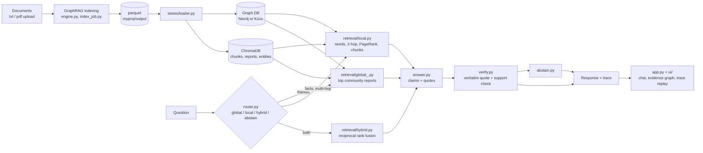

# ThemeGraph

ThemeGraph is a split-screen knowledge-graph Q&A app built on Microsoft GraphRAG. Upload a small corpus
(text or PDF) and GraphRAG extracts entities, relationships and themed communities; the loader puts them
into a **graph database** (Neo4j, or embedded Kùzu) and a **vector database** (ChromaDB). A router sends each
question to **global** retrieval (themes), **local** retrieval (facts and multi-hop links), **hybrid** (both,
fused) or **abstains**. Every answer is split into claims with verbatim quotes that are checked against the
source text, and the clickable graph on the right replays the exact retrieval path: seeds, hops, communities,
chunks and documents. A resumable benchmark compares routed ThemeGraph with GraphRAG's own basic, local and
global search.

## Architecture



All LLM calls go through `backend/llm.py`, which caches every response in SQLite (`cache.db`) and retries with
backoff. GraphRAG's own indexing and baseline searches use its LiteLLM client with the same Gemini key.

## Setup (fresh clone to running app)

```powershell
python -m venv .venv
.venv\Scripts\activate                 # macOS/Linux: source .venv/bin/activate
pip install -r requirements.txt
copy .env.example .env                 # then set GEMINI_API_KEY and NEO4J_PASSWORD

.\tasks.ps1 up                         # start Neo4j in Docker (skip if using Kùzu, see below)
.\tasks.ps1 index                      # GraphRAG indexing of myproj/input + schema notes; loads the stores
.\tasks.ps1 load                       # (re)load Neo4j/Kùzu + ChromaDB from the parquet output
.\tasks.ps1 app                        # streamlit run app.py
```

No API key or index yet? `.\tasks.ps1 mock` runs the same UI on built-in sample data (`MOCK=1`).
Already indexed but out of quota? `.\tasks.ps1 demo` preloads three recorded answers (`--demo-seed`).

### HTTP API (for web frontends)

`api.py` exposes the same pipeline over HTTP for frontends such as pixel-style-replay:

```powershell
.\tasks.ps1 api                        # uvicorn api:app --reload --port 8000
```

The API always serves the real index built from the uploaded documents (no demo data). Each build records the
exact files it used; after any upload or delete the index is reported as stale and `/api/ask` returns 409 until
the graph is rebuilt, so answers always come from the current documents.

| Endpoint | What it does |
|---|---|
| `GET /api/health` | `{api_key, index_ready, fresh, documents, reason}` |
| `GET/POST /api/documents`, `DELETE /api/documents/{name}` | list, upload (multipart `files`, .txt/.pdf), delete corpus files |
| `GET/POST /api/index`, `POST /api/index/cancel` | build status, start a build, cancel it |
| `GET /api/insights` | entities, relationships and themes of the current index (`ready: false` with a reason when stale) |
| `POST /api/ask` | `{question, mode}` → the pipeline `Response` (answer, claims, sources, trace) |

CORS allows any `localhost` port; add other origins with `CORS_ORIGINS` (comma-separated).

### All `tasks.ps1` targets

| Target | What it does |
|---|---|
| `up` | `docker compose up -d --wait neo4j` (Neo4j 5 with auth from `.env`, named volume, healthcheck) |
| `index` | GraphRAG indexing into a staging folder, swapped in only on success; then loads the stores |
| `load` | `python -m backend.stores.loader --reset`: parquet into the graph store and ChromaDB, prints counts |
| `app` / `mock` / `demo` | the app; with sample data; with three preloaded answers |
| `test` | offline unit tests (`OFFLINE=1`, fakes for Neo4j, Chroma and the LLM) |
| `smoke` | 3 end-to-end questions: thematic, multi-hop, unanswerable |
| `check` | offline tests, store health and the smoke test, printing PASS or FAIL for each |
| `eval` | resumable benchmark (`eval.run --resume --sleep 4`) then `eval.report` |
| `inspect` / `graph` | regenerate `docs/schema_notes.md`; write static graph HTML to `myproj/output` |

`make` has the same targets for macOS/Linux.

## Configuration (`.env`)

| Variable | Purpose | Default |
|---|---|---|
| `GEMINI_API_KEY` | Gemini key from [AI Studio](https://aistudio.google.com/apikey); used by GraphRAG and `llm.py` | required |
| `LLM_MODEL_CHEAP` | routing and the support check | `gemini-3.5-flash-lite` |
| `LLM_MODEL_STRONG` | answers, question drafting, eval judge | `gemini-3.5-flash-lite` |
| `LLM_BASE_URL` | OpenAI-compatible endpoint for `llm.py` | Gemini's OpenAI endpoint |
| `GRAPH_BACKEND` | `neo4j` or `kuzu` | `neo4j` |
| `NEO4J_URI`, `NEO4J_USER`, `NEO4J_PASSWORD` | Neo4j connection; the password also seeds the container | `bolt://localhost:7687`, `neo4j`, required |
| `KUZU_PATH` | embedded Kùzu database file | `myproj/kuzu` |
| `CHROMA_PATH` | ChromaDB persistent folder | `myproj/chroma` |
| `GRAPH_ROOT` | GraphRAG project folder | `myproj` |
| `ABSTAIN_MIN_SCORE` | minimum retrieval signal (matched entities or reports) | `1` |
| `ROUTER_MIN_CONF` | below this router confidence, fall back to local | `0.5` |
| `COMMUNITY_LEVEL` | community level for the GraphRAG baselines | `2` |

The Gemini free tier is rate limited: the LLM cache makes repeat questions free, the benchmark runs one
question at a time with `--sleep`, and nothing calls the LLM inside a per-item loop.

### Graph and vector stores

- **Neo4j (default):** `.\tasks.ps1 up`, then `.\tasks.ps1 load`. Browse at http://localhost:7474. Schema:
  `(:Document)-[:HAS_CHUNK]->(:Chunk)-[:MENTIONS]->(:Entity)-[:REL]->(:Entity)-[:IN_COMMUNITY]->(:Community)`,
  with uniqueness constraints on ids and an index on `Entity.title`. Ids are deterministic, so loads are idempotent.
- **Kùzu (no Docker):** set `GRAPH_BACKEND=kuzu` and run `.\tasks.ps1 load`. Same schema and tests, embedded in
  one file. **Kùzu is archived upstream (October 2025) and pinned to `kuzu==0.11.3`**; it is a fallback only.
- **ChromaDB:** always embedded (`CHROMA_PATH`), with collections `chunks`, `reports` and `entities`, embedded
  locally by Chroma's default ONNX model (all-MiniLM-L6-v2), so indexing the vectors costs no Gemini calls.
- If the graph database is unreachable, the app falls back to an in-memory graph and the header chip turns red.

## Using the app

- **Left:** a Documents panel (upload, delete, *Build knowledge graph* with live stages and Cancel), store status
  chips, example questions, and chat. Each answer shows a route badge (hybrid answers show a *Theme N + Facts M*
  split), an N-step trace badge, claim cards with verified quotes and a theme/fact origin chip, sources,
  follow-ups, and a search-mode picker (Auto, Global, Local, Hybrid and the three GraphRAG baselines).
- **Right tabs:**
  - **Graph:** an interactive evidence graph with numbered trace badges. *Replay* steps through the trace with
    captions, a community halo appears for themes, and *Docs* shows square document nodes with dashed *cites*
    edges. Clicking an entity or document opens a drawer with excerpts and *Ask about this*.
  - **Themes:** community reports. **Sources:** cited chunks with highlighted quotes.
  - **Compare:** ThemeGraph vs GraphRAG basic on the same question.
  - **Results:** benchmark charts and extraction precision.
- The sample corpus in `myproj/input/` is 10 short documents about a fictional city's clean energy transition,
  written with deliberate cross-document links.

## How the requirements are met

See [docs/requirements_traceability.md](docs/requirements_traceability.md) for each requirement's
files, test and demo step.

## Results

`.\tasks.ps1 eval` writes `eval/results/summary.csv` and `summary.md`; `python -m eval.write_readme_table`
replaces the block below. Systems: `graphrag_basic`, `graphrag_local`, `graphrag_global` (GraphRAG's own
searches, with the same answer and verification step) and `themegraph_routed`.

<!-- RESULTS:START -->
#### All questions

| system | n | correct | evidence_recall | quote_validity | verified_claims | router_acc | abstain_precision | abstain_recall | latency_ms | llm_calls |
|---|---|---|---|---|---|---|---|---|---|---|
| graphrag_basic | 4 | 0.75 | 0.60 | 1.00 | 3.50 | - | - | - | 34773 | 2.00 |
| graphrag_global | 4 | 0.50 | 0.83 | 1.00 | 3.00 | - | - | - | 25624 | 1.50 |
| graphrag_local | 4 | 0.50 | 0.69 | 1.00 | 3.25 | - | - | - | 39993 | 2.00 |
| themegraph_routed | 4 | 0.25 | 0.94 | 0.95 | 2.75 | 1.00 | - | - | 23461 | 3.00 |

#### Thematic questions

| system | n | correct | evidence_recall | quote_validity | verified_claims | router_acc | abstain_precision | abstain_recall | latency_ms | llm_calls |
|---|---|---|---|---|---|---|---|---|---|---|
| graphrag_basic | 4 | 0.75 | 0.60 | 1.00 | 3.50 | - | - | - | 34773 | 2.00 |
| graphrag_global | 4 | 0.50 | 0.83 | 1.00 | 3.00 | - | - | - | 25624 | 1.50 |
| graphrag_local | 4 | 0.50 | 0.69 | 1.00 | 3.25 | - | - | - | 39993 | 2.00 |
| themegraph_routed | 4 | 0.25 | 0.94 | 0.95 | 2.75 | 1.00 | - | - | 23461 | 3.00 |
<!-- RESULTS:END -->

Metric notes:
- Evidence recall is measured against gold chunks: `gold_chunk_ids`, or every chunk of the `gold_docs` when a
  question has none. Report evidence counts the chunks behind that community.
- Router accuracy counts hybrid as correct for questions marked `mixed`.
- Correctness is a secondary LLM judge against the reference answer, with the systems in a seeded random order.
- `llm_calls` counts calls through `backend/llm.py` only. GraphRAG's internal search calls for the baselines are
  not counted, so the baselines' true cost is higher than shown.
- The table above covers only the first 4 (thematic) questions, from the acceptance run. Run the full 24 with
  `.\tasks.ps1 eval` (resumable across sessions if the daily quota runs out).

Extraction quality: `python -m eval.extraction_audit` samples 30 relationships and 30 entities into
`eval/results/extraction_audit*.csv`. Fill in the y/n columns, then `--score` writes the precision used by the
Results tab and this README.

## Limitations

- **Extraction accuracy is unmeasured until the audit is filled in.** The audit sheets list likely duplicate
  entities that GraphRAG did not merge (for example `DR. PRIYA RAMAN` / `PRIYA RAMAN` and three
  `HARBOR BLACKOUT` variants), which split evidence across nodes.
- **Gemini free tier:** rate limits and transient 503s slow indexing and the benchmark; failed pairs are retried
  with `--resume`. The support check is an LLM call, so a rate-limited run can occasionally reject claims whose
  quotes verified, and the answer then abstains.
- **No incremental indexing:** adding documents re-indexes the whole corpus (built in a staging folder, so a failed
  build leaves the previous index live).
- **Small benchmark:** 24 hand-checked questions on a 10-document corpus. On the 4 thematic questions run so far,
  routed ThemeGraph had the highest evidence recall but the lowest judged correctness, so the sample is too small to
  draw conclusions.
- Global answers cite community reports (LLM summaries), not raw text, so their quotes are one step removed from the source.
- No contradiction detection across documents.
- Docker was not available on the development machine, so live runs used Kùzu; the Neo4j store is covered by
  fake-driver tests and the same schema, but was not exercised against a live server here.

## Project layout

```
backend/            config, contracts, llm (cached), engine (GraphRAG), index_job, router, answer, verify, abstain,
                    pipeline, graph (payload), path (baseline highlights)
backend/stores/     graph_store (protocol, Neo4j, in-memory), kuzu_store, vector_store (Chroma), loader, health
backend/retrieval/  local (seeds, 2-hop, PageRank, chunks), global_ (reports), hybrid (RRF)
app.py              Streamlit split screen (thin: wires ui/ modules together)
ui/                 state, data, chat, ingest_panel, themes, sources, compare (Compare + Results), demo_seed,
                    styles, mock, graph_component/ (HTML/JS, vendored vis-network)
eval/               questions.jsonl, make_questions_draft, run, metrics, report, extraction_audit,
                    write_readme_table, results/
tests/              offline tests with fakes (no API key, Docker or network)
scripts/            smoke_test.py, inspect_output.py, graph_component_demo.py
docs/               requirements_traceability.md, demo_script.md, demo_seed.json, schema_notes.md, graphrag_settings.md
myproj/             GraphRAG root: settings.yaml, input/, prompts/, output/ (+ kuzu, chroma when loaded)
```

## Credits

[Microsoft GraphRAG](https://github.com/microsoft/graphrag), [Neo4j](https://neo4j.com),
[Kùzu](https://github.com/kuzudb/kuzu), [ChromaDB](https://www.trychroma.com), [NetworkX](https://networkx.org),
[Streamlit](https://streamlit.io), [vis-network](https://visjs.github.io/vis-network/),
[OpenAI Python SDK](https://github.com/openai/openai-python), pandas, pyarrow, pypdf, pydantic.
