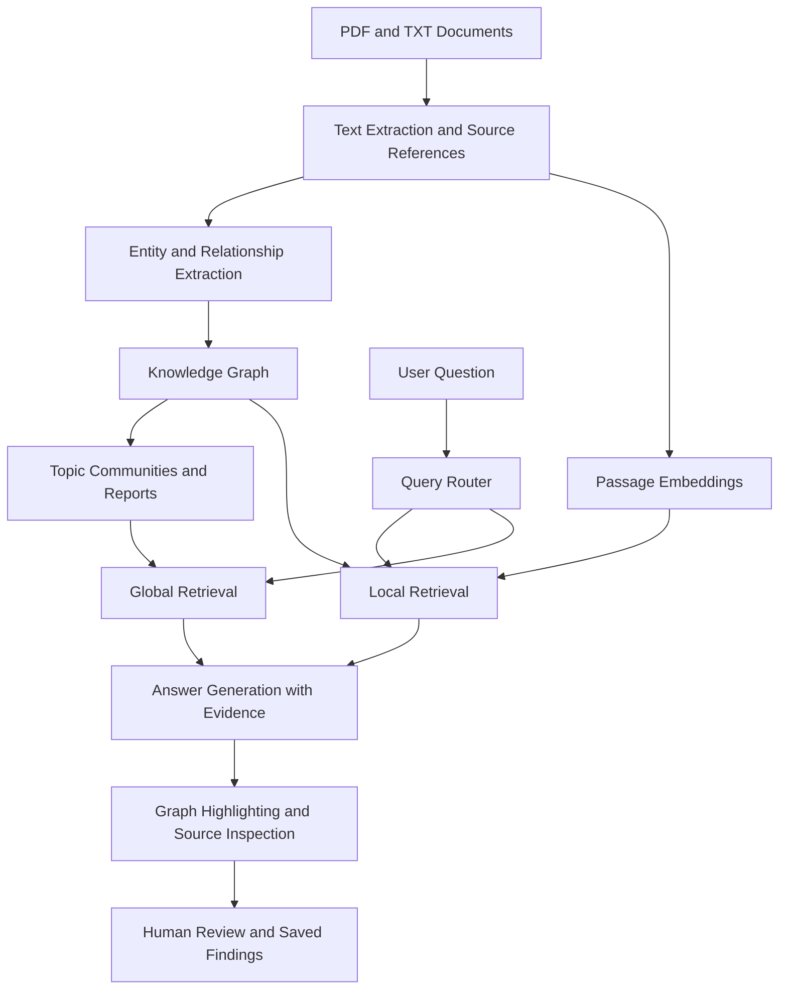

# 🥝 Team Kiwi
### 🏆 Hypnexis Hackathon

# 🔍 THEMEGRAPH
## Connect documents. Trace evidence. Build clarity.

🧠 **A gamified knowledge workspace for lawyers, income tax officers, detectives, and other working professionals who analyse large document collections.**

---

## 📌 About THEMEGRAPH

THEMEGRAPH transforms scattered documents into an interactive knowledge graph, helping professionals explore relationships, ask questions, and verify findings against original sources.

The platform connects **people, organisations, transactions, agreements, events, and topics** across multiple documents.

Our goal is to help users move from simply receiving an answer to understanding and inspecting the evidence behind it.

> 🚧 **Project Status:** Hackathon prototype in development. The features and architecture below describe our proposed solution. Working functionality should be confirmed against the repository.

---

## ❓ Problem Statement

Lawyers, income tax officers, and investigators regularly work with information spread across:

- 📂 Case files and investigation reports.
- 📜 Contracts and agreements.
- 🧾 Invoices and transaction records.
- 🏦 Bank statements and financial documents.
- 📝 Statements, correspondence, and supporting evidence.

Important relationships may appear across several files, making manual analysis difficult.

### ⚠️ Key Challenges

- 🔎 Repeatedly searching through documents.
- 🕸️ Finding connections across different files.
- 📍 Locating the exact source supporting a claim.
- 🧩 Separating documented facts from assumptions.
- 🔄 Revisiting previous findings and unresolved questions.

**Finding an answer is useful. Understanding and verifying its supporting connections is equally important.**

---

## 💡 Our Solution

THEMEGRAPH proposes a document intelligence workspace that combines:

- 🧠 AI-assisted document processing.
- 🕸️ Interactive knowledge graphs.
- 🗂️ Topic-based organisation.
- 💬 Natural-language questions.
- 📖 Source-linked evidence inspection.
- 🎮 Professional gamification.
- 👤 Human review and correction.

### 🔄 User Workflow

**Upload → Connect → Organise → Ask → Verify → Save**

1. 📤 Upload related documents.
2. 📄 Extract text while preserving source references.
3. 🔗 Identify entities and relationships.
4. 🗂️ Group connected information into topics.
5. 💬 Ask factual or thematic questions.
6. 🔍 Inspect relevant graph connections and source passages.
7. 📌 Save reviewed findings and unanswered questions.

---

## 👥 Target Audience

| Professional | Intended Use |
|---|---|
| ⚖️ Lawyers | Connect case files, contracts, and statements; trace findings to supporting documents. |
| 🧾 Income Tax Officers | Explore documented relationships between companies, invoices, and transactions. |
| 🕵️ Detectives and Investigators | Reconstruct events, follow evidence trails, and identify missing information. |
| 💼 Other Working Professionals | Explore and verify knowledge across document collections. |

---

## ✨ Planned Features

### 📤 Multi-Document Upload
Bring related PDF and TXT files into one workspace.

### 🧠 Entity and Relationship Extraction
Identify people, organisations, documents, transactions, and their connections.

### 🕸️ Interactive Knowledge Graph
Explore labelled relationships across multiple documents.

### 🗂️ Topic Communities
Group related information to support broad questions about the collection.

### 💬 Natural-Language Questions
Ask questions without manually searching every document.

### 🔀 Intelligent Query Routing
Select the retrieval strategy according to the question:

- **Local search:** Specific entities and relationships.
- **Global search:** Broad themes and topic-level summaries.

### 📖 Evidence-Linked Connections
Inspect the supporting passage and document reference behind a relationship.

### 🎯 Answer-Linked Graph Highlighting
Highlight retrieved entities, relationships, or communities alongside an answer.

### ✏️ Human Review and Correction
Review extracted connections and merge duplicate entities.

### 📌 Saved Findings
Preserve reviewed evidence and unresolved questions.

### 🚫 Missing-Evidence Handling
Explain when the available documents cannot support an answer.

> Retrieved context is not automatically proof that every generated claim is supported. Claim-to-source validation remains essential.

---

## 🎮 Gamified Professional Experience

THEMEGRAPH uses an investigation-bureau theme to make document exploration more engaging.

### 🏢 Connected Work Areas

| Work Area | Purpose |
|---|---|
| 📥 Document Intake | Upload and organise source files. |
| 💰 Financial Analysis | Explore invoices, payments, and transaction relationships. |
| ⚖️ Legal Review | Inspect agreements, statements, and supporting records. |
| 🧩 Case Reconstruction | Organise events, connections, and open questions. |
| 🕸️ Connected Evidence | Explore the shared knowledge graph. |

### 🏁 Meaningful Progress

- 📋 Investigation stages.
- 🔍 Source-review milestones.
- 🗃️ Evidence inventories.
- 📌 Saved findings.
- ❓ Unresolved questions.

**Progress reflects evidence reviewed—not accusations made or guilt established.**

Core evidence should remain accessible without artificial game restrictions.

---

## 🧪 Example Use Case

Imagine a professional uploads:

- 📄 A company profile.
- 🏦 A bank statement.
- 🧾 An invoice.
- 📜 A supply agreement.

The documents separately identify a director, record a payment, reference an invoice, and name a supplier.

### 💬 User Question

> “How are these companies connected?”

### 🔍 Intended Response

THEMEGRAPH should:

1. Show the documented relationship path.
2. Highlight the relevant connections.
3. Provide supporting passages for each step.
4. Identify questions the documents cannot answer.

A recorded payment does not, by itself, establish ownership, tax treatment, or wrongdoing.

---

## 🏗️ Technical Architecture

---

## 🛠️ Proposed Technology Stack

| Component | Technology |
|---|---|
| 🐍 Programming Language | Python |
| 📄 Document Extraction | PyPDF |
| 🧠 Indexing and Retrieval | Microsoft GraphRAG |
| 🤖 Language and Embedding Models | Configurable model provider |
| 🕸️ Graph Database | Neo4j |
| 🔎 Vector Database | LanceDB |
| 🔗 Graph Processing | NetworkX |
| 🖥️ MVP Interface | Streamlit |
| 🎨 Graph Visualisation | PyVis |
| 🔐 Environment Configuration | python-dotenv |

### 📝 Implementation Notes

- Streamlit and PyVis provide an MVP interface.
- The immersive isometric workspace requires additional frontend development.
- Neo4j integration requires explicit implementation.
- NetworkX supports graph processing but does not replace a graph database when one is required.

---

## 🚀 Development Approach

### 1️⃣ Prove the Core Pipeline
Index a small collection of synthetic or public documents.

### 2️⃣ Validate Retrieval
Test local and global queries independently.

### 3️⃣ Connect Evidence
Map retrieved information to graph elements and original passages.

### 4️⃣ Build the Interface
Add document upload, chat, visual exploration, and source inspection.

### 5️⃣ Add Review Tools
Introduce correction, saved findings, and review progress.

### 6️⃣ Evaluate and Improve
Compare outputs with manually checked answers and a basic vector-retrieval baseline.

> Repository-specific installation commands will be added after the implementation and dependency versions are verified.

---

## 📊 Evaluation Plan

| Measure | What We Will Check |
|---|---|
| ✅ Answer Correctness | Does the response match the documents? |
| 📖 Citation Support | Does the cited passage support the claim? |
| 🔗 Relationship Accuracy | Are extracted entities and connections correct? |
| 🗂️ Thematic Coverage | Does the summary represent relevant topics? |
| 🚫 Unsupported Questions | Does the system acknowledge missing evidence? |
| ⏱️ Verification Effort | How easily can users inspect supporting sources? |
| 💰 Processing Cost | What resources are required for indexing and queries? |

**Performance improvements will be claimed only after testing.**

---

## 🌟 What Makes THEMEGRAPH Different?

General-purpose AI assistants can already analyse documents, summarise information, and explain connections.

THEMEGRAPH focuses on a dedicated professional workflow:

- 🕸️ Persistent, labelled relationships.
- 📖 Evidence inspection for individual connections.
- 🔍 Visual exploration across documents.
- ✏️ Human correction of extracted knowledge.
- 📌 Reusable findings and open questions.
- 🎮 Review progress within a gamified workspace.

> **Our intended advantage is making connected knowledge easier to explore, verify, and refine.**

---

## 📈 Expected Impact and Benefits

- 🔎 Less repeated document searching.
- 🧩 Clearer relationships across files.
- 📖 Easier inspection of supporting evidence.
- 🗃️ Better organisation of reviewed findings.
- 🤝 More structured professional review.
- 🎯 More engaging document exploration.

These are expected benefits to be validated through professional pilots.

---

## 💼 Proposed Business Model

### 👤 Professional Subscriptions
Individual access for document-heavy professionals.

### 🏢 Organisation Licences
Annual plans for firms, teams, and institutions.

### 📊 Usage-Based Allowances
Document-processing limits and additional indexing capacity.

### 🛠️ Onboarding and Integration
Support for organisation-specific workflows.

**Pricing, demand, and willingness to pay require validation.**

---

## ⚙️ Feasibility and Limitations

### 🧱 Focused MVP
Start with small collections of text-based PDFs and TXT files.

### 💰 Controlled Processing
Reuse indexed content and monitor model and hosting costs.

### 🔍 Extraction Quality
Review incorrect relationships and duplicate entities.

### 📷 Scanned Documents
OCR is planned beyond the initial text-document workflow.

### 🧮 Numerical and Legal Interpretation
Graph retrieval alone does not guarantee correct calculations or professional conclusions.

### 🔐 Confidential Data
Before real-data pilots, the project requires appropriate:

- Authentication and access controls.
- Protected storage.
- Retention policies.
- Audit trails.
- Review of external model-provider data handling.

These are deployment requirements, not claims of completed implementation.

---

## 🗺️ Roadmap

### 🟣 Phase 1 — Core Prototype
Document ingestion, extraction, topic communities, local/global retrieval, and citations.

### 🔵 Phase 2 — Evidence Workflow
Source inspection, graph highlighting, correction tools, and saved findings.

### 🟢 Phase 3 — Professional Experience
Gamified work areas, timelines, OCR, and document-update comparison.

### 🟠 Phase 4 — Secure Pilots
Access management, audit trails, deployment hardening, and professional feedback.

---

## 📚 Research and References

### 🧠 Technical Research

- [GraphRAG — From Local to Global: A Graph RAG Approach to Query-Focused Summarization](https://arxiv.org/abs/2404.16130)
- [Retrieval-Augmented Generation for Knowledge-Intensive NLP Tasks](https://arxiv.org/abs/2005.11401)
- [RAGChecker — A Fine-grained Framework for Diagnosing Retrieval-Augmented Generation](https://arxiv.org/abs/2408.08067)

### 📰 Problem Context

- [The Indian Express — Document-handling pressures in Delhi courts](https://indianexpress.com/article/cities/delhi/file-pe-file-at-delhis-digital-courts-why-massive-pendency-of-cases-gives-staff-sleepless-nights-9913687/)
- [Reuters, via Investing.com — AI hallucinations in court papers](https://www.investing.com/news/world-news/ai-hallucinations-in-court-papers-spell-trouble-for-lawyers-3875352)
- [The Indian Express — Plans for digital-evidence analysis procedures](https://indianexpress.com/article/business/to-issue-manual-for-new-income-tax-bills-digital-searches-seizures-says-cbdt-chief-10145487/)

These references inform the problem framing and technical approach. They do not establish this prototype’s effectiveness.

---

## 🥝 Our Team

| Member | Role | Institution |
|---|---|---|
| Amulya Singla | Team Leader | University of Delhi |
| Medhansh Garg | Team Member | Delhi Technological University |
| Himanshu Singla | Team Member | University of Delhi |

### 🏆 Built for Hypnexis by Team Kiwi

---

## 🎯 Our Vision

Help professionals move from scattered documents to connected, inspectable knowledge.

### 🔍 Connect documents. Trace evidence. Build clarity.
